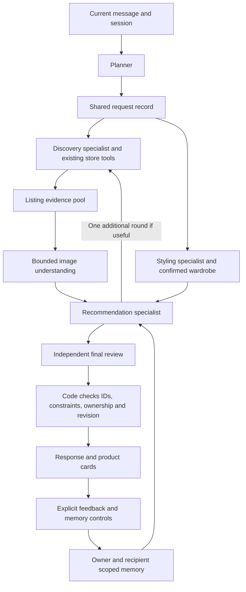

# Chauffeur recommendation architecture and build specification

Status: production release, 21 October 2026. The new authenticated web route is implemented behind `RECOMMENDATION_V2_OWNERS`; development and production are enabled for signed-in web requests. Sections below retain the design contract. The implementation notes here identify the delivered scope and remaining release checks.

## Implemented path

- `recommendationWorkflow.ts` coordinates durable steps. Specialists in `recommendationAgents.ts` use separate Gemini calls and structured outputs. They exchange records, not unrestricted conversations. Existing Convex Agent/Gemini integration and store readers remain.
- `recommendationTasks.ts` owns versioned task/brief/evidence/report records, usage reservations, cancellation, memory revisions and publication. `recommendationRules.ts` defines shared validators and hard checks. Request provenance currently records the source message and hard-field names, not a complete source history for every field.
- `shopperMemory.ts` supports confirmed preferences, tentative statements and past-task/outcome episodes. Retrieval is owner/recipient/category scoped, at most 12 of 100 stored entries. Tentative/episode entries older than 90 days are not retrieved; this is not a data-deletion policy. No retrospective private-chat import occurs. Explicit legacy saved style preferences are read as confirmed memory and remain editable through their existing controls. Planner requirements do not receive historical memory; recommendation and styling receive relevant memory for judgement. Current session requirements remain available to the planner.
- Preferences has add/edit/remove and learning/use controls. Product details can record explicit likes, dislikes, purchases and returns, including gift recipient. These reports never create wardrobe ownership. Existing clicks/saves are not yet automatically imported into personal memory. Natural-language forgetting points to the memory controls rather than claiming an unperformed deletion. Turning memory off does not delete chat history. An explicit temporary/do-not-remember request disables personal memory for that turn.
- Retrieval keeps up to 36 hard-matching candidates before the six-card shortlist. Everyday wear is not required in merchant tags. Image observations remain separate from listing facts and unknowns. Missing images stay unknown. A second round searches previously unattempted stores; it does not yet synthesize new per-store query variants from each evidence gap.
- Limits: eight model calls, 24,000 reserved tokens, twelve images/6 MB total (up to eight per pass, sharing the twelve-image total; 500 KB per fetched image), 115-second task deadline, existing shared 90-second browser recovery deadline. At least 4,000 tokens remain reserved for final review before non-review calls. At most four active architecture tasks and 240,000 reserved tokens/hour by default, configurable server-side. These are conservative reservations, not a billing guarantee or a monthly money cap.
- Code rejects invented IDs, evidence conflicts, invalid prices/requirements, wrong-owner references, stale request or memory revisions and stale wardrobe combinations. Failed judgement yields a labelled listing-only fallback; failed outfit review does not publish unchecked outfits. Comparisons disclose when they reuse previously observed prices.
- `RECOMMENDATION_V2_OWNERS` accepts owner IDs or `*`. Clearing it selects the existing route for new turns; task version is retained for in-flight work. Guest one-request discovery and WhatsApp preparation retain the existing route. The app's established text/voice preparation feeds the new signed-in route; this does not establish voice-first or WhatsApp delivery.

Release checks and measurements are recorded in [TESTING_LEDGER.md](../TESTING_LEDGER.md). Signed-in development memory/feedback checks and production UI checks are recorded in the testing ledger. Broad human ranking quality and real-phone behaviour remain separate from passing code checks. The design's richer attribute-level provenance, automatic click/save learning, detailed rejection-count coverage and image-evidence reuse cache are not claimed as implemented.

## 1. Product contract

Help the shopper find an outfit or item they can use, explain the choice with evidence, and learn from their response. Discovery, styling, wardrobe use and recommendation serve one current goal. Buying something is optional.

A new chat starts a new task, not a new understanding of the person. Relevant confirmed preferences and cautious historical observations should carry across chats. Current instructions win. A gift search must not become the shopper's personal taste. This supersedes the earlier session-only memory direction for the planned system; it now applies to the gated development route, not the existing production route.

Keep Gemini, Convex Agent, Convex Workflow, Convex Auth and existing hosting. Preserve the working store readers and account boundaries. No checkout execution, price-intelligence expansion, new external service, automatic wardrobe ownership inference or real try-on claim is part of this project.

Success is a useful shopper decision, not a count of results. Keep the existing maximum of six product cards. Do not force six weak choices.

## 2. Main design decisions

- One planner owns the current request and the shopper conversation.
- Specialists have narrow responsibilities and exchange structured records through a shared task, not free-form agent conversations.
- A harness is the surrounding Convex code that enforces permissions, tool budgets, deadlines, revision checks and result validation.
- Tools fetch facts; agents interpret meaning and make qualified judgements. Do not create a model-powered agent for every store or database operation.
- Separate listing facts, visual observations and suitability judgements. Every recommendation must identify its evidence and unknowns.
- Retrieve broadly, then assess. An occasion such as everyday wear is a use case, not a required merchant tag.
- Use a bounded improvement loop when discovery evidence is insufficient. Blocked access is not evidence of no inventory.
- Memory is selective, contextual and correctable. Do not replay every old conversation into every prompt.

## 3. Components and authority

| Component | Receives | Returns | Authority and limits |
|---|---|---|---|
| Input preparation | User text, consented voice transcript or image reference | Editable text and attachment references with source | Does not infer personal traits or store permanent taste. Uncertain voice amounts/sizes need clarification. |
| Planner | Latest input, task state, relevant memory, tool capabilities | Task route, updated brief, dependencies, one question if necessary | Proposes requirement changes; code checks explicit authority. Sole owner of the conversation's task interpretation. |
| Memory service | Verified owner, request context, retrieval scope | Relevant confirmed facts, tentative patterns, supporting episodes | Enforces ownership and privacy mode. Agents propose updates; validated writes occur separately. |
| Discovery specialist | Search brief, coverage gaps, eligible tools, remaining budget | Query plan, candidate IDs, coverage report, optional next-search request | Chooses approved tools and bounded queries. Cannot invent products or change hard requirements. |
| Product understanding | Candidate IDs, permitted image bytes, listing observations | Evidence-labelled visual attributes, conflicts, unknowns | Can describe visible garment properties. Cannot infer composition, durability, actual fit or comfort from appearance. |
| Wardrobe specialist | Explicit wardrobe-related task, confirmed available owned IDs | Relevant pieces, outfit candidates and missing pieces | Never invents ownership or uses unavailable pieces. Does not start shopping unless requested. |
| Styling specialist | Occasion, preferences, candidate/owned-item evidence | Styling criteria, combinations and trade-offs | Does not prescribe body ideals or guarantee fit; optional personal context stays consent-bound. |
| Recommendation specialist | Current brief, evidence pool, relevant memory, specialist results | Ordered shortlist/outfits, reasons, unknowns, optional evidence request | Selects only supplied valid IDs. Can request a specific discovery improvement, not silently broaden budget/brand. |
| Response composer | Validated decisions, evidence, coverage and language | Short coherent response with cards and next action | Usually the planner's final step; cannot introduce unsupported facts or reorder choices without recording why. |
| Final checks | Proposed response and referenced records | Pass, exact repair request or supported partial response | Hard checks run in code. A separate model review is reserved for complex/ambiguous styling claims. |
| Outcome recorder | Explicit feedback and UI events | Task feedback, proposed memories, confirmed outcome records | Saves, clicks, purchases, returns and satisfaction are distinct events. |

Agents may call specialist tools through the coordinator. They cannot recursively spawn unbounded work. Independent wardrobe lookup and store retrieval may run concurrently after the planner establishes scope. Product inspection follows retrieval; recommendation follows sufficient evidence.

## 4. Shared records and handoffs

These are the full logical design contracts; the implemented subset and differences are listed above. Start with optional fields and separate tables so older saved records and open clients remain compatible.

### RequestBrief

- ownerId, conversationId, sessionId, taskId, revision, createdAt, schemaVersion.
- Goal: discover, style, wardrobe, compare, refine, mixed, or clarify.
- Recipient: self, specified other person, or unknown. Never mix recipient preferences.
- Requested outcome and item categories; links to earlier task only when relevant.
- Hard requirements: value, field, source message/event, scope, explicitness.
- Soft preferences: value, context, source, confidence category (confirmed/tentative).
- Budget: currency, ceiling, whether item-level or whole-outfit; unknown delivered costs stay unknown.
- Category-specific sizes and systems; do not convert without evidence.
- Open questions, answered/skipped questions, exclusions, current product references.
- Memory entries actually used, wardrobe permission, privacy mode and requested language.

The current brief is the single source of truth. Each specialist receives only its relevant subset. If a user changes budget while search runs, revision increases and old results cannot publish.

### TaskRun and SpecialistResult

TaskRun stores status (planning, needs_input, retrieving, assessing, refining, ready, satisfied, failed, cancelled), task dependencies, remaining call/time budget, run revision and completion reason. Ready is not satisfied; satisfaction requires explicit feedback.

Every SpecialistResult includes taskId, revision, component/version, referenced IDs, evidence references, unresolved gaps, usage and outcome. Allowed outcomes: ready, needs_input, needs_evidence, partial, unavailable. Validators reject wrong-owner IDs, stale revisions, extra products and malformed outputs.

### Candidate and ProductEvidence

Keep product identity separate from merchant listing and variant. A listing observation includes source URL/store, title, observed price/currency, observation time, selected/unknown variant, availability evidence and image references. Preserve unknown size stock and starting-price qualifiers.

Each attribute carries its value and source type: merchant text, merchant specification, image observation, user confirmation or model judgement. Conflicting image/text information is flagged, not silently merged. Reused image observations are tied to the image version and model/prompt version; prices and availability need separate freshness checks.

Deduplicate exact listing/variant identities first. Similar-looking items can remain alternatives; image similarity alone does not prove identical products.

### RecommendationDecision

Contains selected IDs, ordered reasons linked to evidence, relevant memory references, known compromises, unknowns, rejected candidate reasons, coverage sufficiency and next action. No free-form invented URLs/prices. Render prices and merchant names from validated records, not generated prose.

### CoverageReport

For each attempted tool/store: query, bounded pages attempted, readable or unavailable, candidate count, rejection counts by reason, elapsed time and safe failure category. Distinguish no readable evidence, no constraint matches, missing details and weak suitability.

## 5. Four complete shopper journeys

All examples below are invented design cases, not customer records or verified recommendations.

### A. New shopper: everyday clothing

Input: “A navy T-shirt for everyday use, up to ₹900.” No history exists.

1. Planner identifies discovery, captures colour/category/ceiling, and asks one missing relevant detail at a time. It does not invent audience, fit or material preferences.
2. Discovery searches core item terms across eligible sources. Everyday is not required in titles. Missing size must not be reported as verified stock.
3. Product understanding inspects a bounded varied pool for visible silhouette, neckline and graphics, retaining listing facts independently.
4. Recommendation compares suitability for the stated use, price and evidence. Without personal taste, it can show a small range of clearly explained options instead of pretending to know a favourite style.
5. Composer explains concrete differences, such as a plain design versus a small graphic, with supported material details and uncertainty.
6. “The graphic is too loud” updates this task immediately. It becomes a task-scoped observation; a single rejection does not establish a universal dislike of all prints.

Accept: no everyday-tag requirement; no guessed permanent preferences; matching priced products only; missing pictures handled honestly; no six-card filler.

### B. Returning shopper, new chat and new category

Known memory: confirmed dislike of large logos on casual tops, category-specific sizes, past casual-top budget. Input: “Shoes for a weekend city trip.”

1. Memory service retrieves relevant style preferences and shoe-related history, not the whole top-shopping transcript.
2. Planner starts a new task. It does not reuse the T-shirt budget or clothing size as shoe constraints. It asks for shoe size/system or budget when needed.
3. Styling interprets intended use without claiming pictured shoes will be comfortable. Discovery gathers shoes; recommendation considers supporting construction/material information and unknowns.
4. If the shopper says “Something bold this time,” current direction overrides the usual understated preference for this task.
5. An optional short note explains any meaningful inherited preference and allows correction. A reload retains the task; a new chat retains relevant personal understanding.

Accept: appropriate cross-chat recall; no stale category budget/size; current override wins; missing history causes a normal new-user path rather than failure.

### C. Owned wardrobe plus optional purchase

Input: “Make a dinner outfit with my navy trousers. I can buy a top under ₹1,800 if needed.”

1. Planner routes a mixed task and authorises use of wardrobe for this request. If several owned navy trousers exist, resolve the reference before committing to a combination.
2. Wardrobe specialist retrieves confirmed available pieces. Styling first considers an owned-only outfit.
3. Discovery is permitted for the optional top, using its item-level ceiling. Existing trousers' colour is coordination context, not a requirement that the new top also be navy.
4. Recommendation compares supported owned-only and purchase-assisted combinations. Every garment refers to a real owned or sourced ID.
5. If the trousers become unavailable mid-run, stale combinations cannot publish; recompute within remaining limits or ask the shopper to choose another piece.

Accept: no forced purchase; no invented ownership; no irrelevant wardrobe leakage; explicit pairing rationale; current inventory checked at publication.

### D. Previous chat, refinement, gift and outcome

Input in an existing chat: “The second one, but less shiny. This is for my brother.”

1. Planner resolves the referenced batch and product ID. If ambiguous, ask which item. It marks the recipient as another person and excludes the shopper's own size/body assumptions.
2. Product understanding uses available pictures to assess visible sheen, with uncertainty about lighting. Recommendation retains still-suitable earlier candidates; only explicit rejections are banned.
3. If alternatives are poor, discovery receives a specific request for less visibly shiny alternatives under the unchanged constraints. It gets at most the permitted improvement round.
4. “Show more” excludes already shown picks; “retry” rechecks the current request; a refinement may reuse a matching pick after refreshing evidence.
5. “I bought it for him” records a user-reported purchase for the recipient. It does not silently add the garment to the shopper's wardrobe or claim merchant verification.
6. Later feedback about fit or satisfaction is linked to that item and recipient. It does not become a universal dislike of the brand.

Accept: stable references, correct recipient, honest image uncertainty, distinct retry/more/refinement semantics, no inferred purchase from a click.

## 6. Memory behaviour

### Layers and precedence

1. Current explicit instruction.
2. Confirmed current-task context.
3. Relevant confirmed personal preferences/settings.
4. Tentative patterns from relevant past episodes.

Store task memory, confirmed profile facts, episode summaries, tentative patterns, owned inventory and outcomes separately. Each persistent memory includes owner, recipient, category/occasion scope, source event IDs, confidence category, first/last observation, last confirmation, expiry/review policy and superseded/deleted state.

Explicit general statements (“I never like large logos”) can become confirmed personal preferences. Task-limited statements (“no logos for this event”) stay scoped. Repeated saves may propose a tentative preference but cannot become a hard restriction. Do not infer body traits, financial capacity or identity from purchases/photos.

Retrieve by owner and task relevance; exclude deleted, contradictory, irrelevant-recipient and privacy-disabled records before model context construction. Initial retrieval uses structured category/recipient/occasion filters plus short episode summaries. Add semantic search only if evaluations demonstrate missing relevant memories; a new database is unnecessary.

Resolve contradictions by context first, then explicitness and recency. Preserve the evidence for a correction; never ask a model to silently merge conflicting facts into certainty. Old unconfirmed patterns weaken over time; confirmed sizes should be periodically reviewable rather than assumed permanent.

### Controls and retention

Provide “What Chauffeur remembers,” edit/remove, and a temporary-chat/personalisation-off option. New chat clears the active task, not confirmed personal memory. Task reset and forgetting personal memory must be distinct actions.

Deleting or correcting a memory must invalidate derived summaries and future retrieval, including relevant cached context. Define retention periods and deletion propagation before broad rollout; avoid retaining raw voice/media beyond existing consented needs. Model logs should contain safe IDs, decisions and usage by default, not unrestricted private chats or photos.

For historical migration, do not automatically turn all old chats into confirmed profile facts. Preserve explicit saved settings. Relevant older episodes may inform a tentative interpretation with provenance; ambiguous recipients and unconfirmed purchase claims remain unknown. New memory behaviour needs visible product explanation and controls, not a hidden switch.

## 7. Discovery and judgement loop

1. Planner establishes a brief and separates requirements from preferences.
2. Discovery produces a query plan using approved tools and available source capabilities.
3. Code gathers a bounded pool and rejects invalid URLs, unusable prices, hard conflicts and wrong audiences/categories.
4. Product understanding inspects remaining evidence. Choose a varied pool before visual assessment so a crude initial ranking does not eliminate all good candidates.
5. Recommendation evaluates current use, taste, visual coherence, material evidence, budget and meaningful variety. No numerical confidence percentage should masquerade as calibrated certainty.
6. If useful evidence is missing, return one concrete request with a reason and expected benefit. The harness approves it only within the original limits.
7. Reassess once, then return supported options, one useful question or an honest limitation.

No optional preference silently becomes a hard filter. Unknown required facts cannot be labelled verified. Missing images allow a text-supported recommendation with disclosed visual uncertainty. An image/text contradiction may require a product-detail check or removal from the strict shortlist.

Budget is a ceiling. Preserve the existing soft spending preference for compatibility in the first version, but measure whether it harms relevance; never treat higher price as quality. Do not make an unannounced price-policy change inside the new judge.

### Tools

- Read relevant memory, current task and confirmed wardrobe.
- Search existing supported stores through fixed readers and existing Browserless recovery policy.
- Fetch supported product details and approved public product images with host/type/size/time checks.
- Validate candidate records and current listing observations.
- Inspect bounded images through Gemini.
- Save explicit feedback, proposed memory changes and confirmed outcomes.

Merchant text, images and tool responses are untrusted data, never authority to change instructions or invoke arbitrary URLs. A product agent cannot call checkout, credentials or arbitrary network tools.

## 8. Initial operating limits and failures

These are implementation starting limits to evaluate, not measured performance promises:

- At most one planner call, one discovery-planning call, one batched image assessment, one recommendation call and one composition call for an ordinary new search. Skip unnecessary calls.
- Optional styling call only for requests needing styling; wardrobe read is ordinary code unless outfit reasoning is needed.
- Initial image assessment: at most 12 candidates, one image each. A further assessment, if justified, shares the same turn-wide candidate/image budget rather than replenishing it.
- At most one targeted discovery improvement and one recommendation reassessment. No recursive worker calls or automatic model retries. An optional reviewer consumes an explicit reserved call allowance.
- All routes share an enforced total model-call cap, image-byte cap, token reservations and deadline. Proposed initial total cap: 8 model calls per turn, including review/reassessment. If a complex route exceeds the allowance, return useful partial work or ask a focused question.
- Preserve current store page limits, eligible recovery sources, two-at-a-time browser concurrency and maximum seven browser pages. Improvement rounds share these limits; they do not reset them. Never add browser recovery for readable no-matches or unverified new stores.
- Preserve the current browser recovery deadline. Set and enforce an overall turn deadline before enabling the new route; image analysis and later judgement cannot run beyond it.
- Add application-wide usage accounting and configurable concurrency/spend stops before broad rollout. A monthly monetary limit is a builder product choice, still undecided; do not invent an approved amount or claim provider hard caps are configured.

Failures: a memory read failure uses current task only and does not overwrite memory; an unavailable image leaves visual attributes unknown; blocked sources stay unavailable; failed judgement returns an honestly labelled evidence-only list if safe; a failed final validation gets one bounded repair or a plain failure/partial response. Never label a fixed-rule fallback as AI judgement.

## 9. Build phases and code mapping

| Phase | Work | Existing code to reuse or adapt | Exit check |
|---|---|---|---|
| 0: baseline | Capture synthetic journey cases, current candidate pools and measured baseline; establish record contracts | evals/, discoveryHandoff.ts, TESTING_LEDGER.md | Deterministic replay can separate retrieval failures from ranking failures. |
| 1: task and memory foundation | Versioned brief, owner/recipient-scoped memory, provenance, corrections and controls | schema.ts, aiConversations.ts, conversationCore.ts, shoppingContext.ts | Four memory journeys pass; no cross-account/recipient leakage; deleting memory invalidates derived context. |
| 2: harness and planner | Route tasks, validate specialist results, reserve budgets, cancellation and stale-result checks | discoveryWorkflow.ts, discoveryCoordinator.ts, shoppingAI.ts, aiDecision.ts | Mixed tasks route correctly; limits enforced server-side; older clients remain usable. |
| 3: discovery evidence pool | Separate candidate collection from final six-card selection; coverage and evidence records | liveDiscovery.ts, store readers, discoveryRules.ts, ranking.ts | Retrieval preserves constraints, candidates remain traceable, paid recovery limits unchanged. |
| 4: understanding and recommendation | Bounded image assessment, evidence-backed selection, reason checks | discoveryStyling.ts, stylist rules, existing Gemini integration | Human-reviewed comparison beats or meaningfully improves the baseline without critical factual errors. |
| 5: controlled improvement | One evidence-driven discovery retry within shared limits | Workflow + coverage records | Improves difficult requests without duplicate paid work or unbounded latency. |
| 6: outcomes and release | Feedback learning, purchase/return reporting, feature flag, monitoring and rollback | profiles, feedback, savedProducts, wardrobe tables and app views | Browser and real-model journey checks pass; rollout decisions based on measured quality/cost. |

Implement additive adapters around existing data and tools rather than deleting the working system at once. A server-side feature flag selects the new route for test accounts first. Record architecture version per run. Rollback routes new turns to the existing workflow without deleting memory or breaking open pages; in-flight runs finish or cancel against their own version.

The current local refinement fixes remain valuable independent changes. Do not treat their passing tests as validation of this planned architecture.

## 10. Acceptance and evaluation

Use invented accounts/items and explicit test consent for any real personal media. Do not copy private user chats into committed fixtures.

- Test each of the four journeys in English, Hindi and Hinglish where applicable.
- Include gifts, current preference overrides, explicit negatives, category changes, multiple budgets, missing size systems, old memories, temporary chats and memory deletion.
- Test missing/contradictory images, unreadable stores, no matching inventory, duplicate variants, unverified size stock and expired prices.
- Test denied ownership, other-user product references, prompt injection in merchant text, repeated workflow steps, double submits, cancellation and late completions.
- Compare old and new recommendation on the same frozen evidence pool to isolate judgement quality. Separately measure live retrieval coverage.
- Have humans judge top-three usefulness, evidence accuracy, diversity and explanation specificity; do not use the same model's self-rating as the release criterion.
- Track explicit useful-shortlist acceptance, corrections needed, unsupported claims, incorrect memory carryover, elapsed time, model/image/store usage and cost per completed task. Clicks/saves are weaker signals, not satisfaction.
- Hard release gates: no known cross-account leakage, no unsupported purchase/ownership claims, no silent hard-constraint relaxation, no stale results overwriting corrections, and no exceeded enforced call budgets in the acceptance suite. Passing a suite is not a universal guarantee.
- Run npm test, npm run build and npm run typecheck:backend for implementation changes; push to development and inspect the relevant web journeys in a browser. Test phone-width logged-out entry and core flow before release; real phone/OTP checks remain separate.

Baseline quality, latency and cost are not measured by this planning task. Set comparative release thresholds after collecting phase-0 results, before tuning the new system. No claim of production readiness follows from this plan.

## 11. Decisions intentionally left open

- Builder's monthly monetary ceiling and spending-limit behaviour; required before broad paid rollout.
- Exact personal-memory retention periods and any retrospective history-import experience; decide before activating history-derived memory broadly.
- Whether relevance should replace the current default 60–100% spending preference; measure separately and explain any product change.

Routine module names, validators, task storage and Gemini prompts are implementation decisions and do not require repeated product approval. Deployment still follows the project's authorised npm run deploy workflow; this specification does not publish anything.

## 12. Research basis

These sources inform the design; none certifies it works for Chauffeur.

- [Anthropic: Building effective agents](https://www.anthropic.com/research/building-effective-agents): routing, planner/worker and evaluation patterns, with caution about unnecessary complexity.
- [Convex agent context](https://docs.convex.dev/agents/context): controlled context and user-scoped cross-thread retrieval.
- [Convex workflows](https://docs.convex.dev/agents/workflows): persistent multi-step execution and recovery.
- [Shopping Companion research](https://arxiv.org/abs/2603.14864): long-term preference errors and attribute verification as shopping-agent failure modes.
- [Google REGEN research](https://research.google/blog/regen-empowering-personalized-recommendations-with-natural-language/): evaluating recommendations alongside feedback and explanation quality.
- [Gemini image understanding](https://ai.google.dev/gemini-api/docs/image-understanding): image input capability, not a guarantee of fashion judgement accuracy.

### Colour evidence correction (21 October 2026)

Broad blue retrieval accepts standard shades including navy, cobalt, azure and indigo; a named shade remains specific. Product understanding compares the dominant photographed product colour with the request rather than trusting merchant labels. Pictured candidates with an explicit colour requirement need a positive image verdict before publication, including deterministic fallback. Missing/uncertain image evidence is not treated as confirmation. An underfilled shortlist can trigger the existing bounded second discovery pass.
